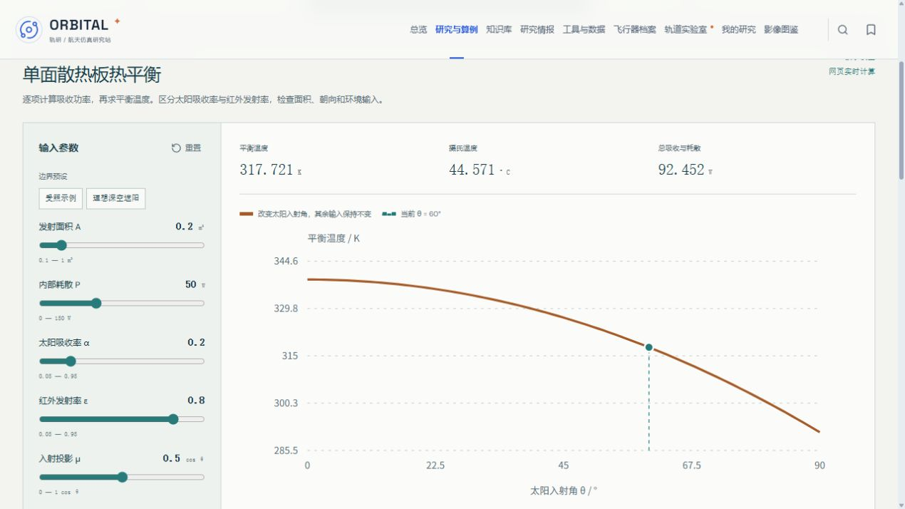

# 轨研 ORBITAL

个人航天仿真研究网站。整理建模方法、工程工具、公开任务资料，并记录 AerospaceSimUE 项目的架构、实现与验证范围。

- 网站：https://windscode.github.io/orbital-research/
- 仓库：https://github.com/Windscode/orbital-research
- 当前版本：11.0.0 · 2026-10-28

## 内容与功能

| 模块 | 当前内容 |
| --- | --- |
| 知识库 | 59 篇笔记，59 个图谱节点、220 条关系、16 条学习路线；按领域查看关系图，手机默认概念列表 |
| 工具与数据 | 88 项开源、源码可见、商业、受限软件及数据资源；输入输出、使用条件、公开应用案例、工具对比 |
| 研究情报 | 29 条技术分析；51 个维护来源，覆盖机构、企业、论文、软件数据、专业媒体；来源关注、筛选、关联与提案 |
| 飞行器档案 | 56 型历史与现代任务选编，公开参数、系统说明、参数推断与不确定性 |
| 三维结构 | 56 个 GLB、56 幅几何预览、56 份构型记录；178 项结构特征关联部件与来源；五个观察方向、正交投影、三向剖切、部件隐藏、隔离、拆分与视图导出 |
| 影像图鉴 | 38 幅图：22 幅实拍/观测、2 幅官方示意、12 幅技术图解、2 幅生成概念图 |
| 个人项目 | 6 个架构层、7 个流程步骤、9 个技术专题、5 个场景、33 条实现说明、4 组历史验证记录；双温场换热、完整液体场、材料接触三篇技术说明与数值表 |
| 轨道实验室 | 六种轨道预设、六参数编辑、NASA 地球纹理、三维传播与地面轨迹；霍曼升轨与平面变化预算；一阶 J₂ 漂移示意；Euler / RK4 / Verlet 误差与收敛验证 |
| 研究方案 | 5 组实施方案、20 项人工检查步骤；关联知识、工具与任务档案 |
| 计算算例 | 两热容换热、单面辐射、Sputnik 质量分布；解析对照、稳定性、功率预算、惯性张量、JSON/CSV 和独立 Python 复算 |
| 研究路线 | 6 个跨学科问题，18 个模型层级、24 个研究步骤、131 项跨目录引用；真实任务影像、输入检查、验收条件与资料包导出 |
| 阅读工作台 | 全站搜索、深链接、章节目录、字号切换、书签、笔记、已读状态与本地备份恢复 |

首页使用真实任务影像。阅读页面采用浅色背景，图谱、轨道与三维工作区采用深色背景。页面适配手机、平板和桌面；内容目录、数值实验、项目深度页与 Three.js 按需加载。

上一版的构型研究：44 型采用重新编写的专属几何，12 型保留已有专属几何并更新共用细节、材质和观察功能。档案卡片可在实际模型投影与任务照片之间切换。构型资料区列出选用的年份/任务状态、文献特征与未知项，可以定位到对应部件。新增笔记涵盖公开影像重建、质量与惯量、网格检查，配套 NASA 3D Resources、MeshLab、ParaView、OCCT 和 CGAL 条目。

## v11 更新

将可运行算例与研究计划分开：`#/research?view=examples` 为三组可复算问题，`#/research?view=routes` 为六个研究路线。算例可从课程、工具、飞行器和项目说明进入，保留参数单位、模型假设和原始资料。Python 复算只使用标准库；`npm test` 需要 Python 3。

个人项目删除公开页面、导出和当前版本数据中的本地/源码路径。以电热交换、完整流体场和材料接触的具体计算过程与历史结果重写主要介绍，更新89件地面材料及最新流体研究范围；没有新增 UE 运行结论。

针对 GMAT、cFS、Thermal Desktop、Voyager、JWST、SLS 与通信预算完成7组实质修订。资源卡区分索引与操作步骤。其余目录仍有待深入的条目，未把结构检查称作全面科学审核。详细变化见 [内容复核记录](research/content-review-v11.json)。

## v10 更新（历史）

这轮从资料深度、模型语义、模块关联、当前源码与响应式布局复核网站。新增轨道定轨、月面着陆、热控能源、推进供给、质量结构、飞行软件六个研究专题；通过输入约定、模型层级与检查条件连接已有目录。入口位于首页、主导航、全站搜索与关联阅读页。

知识库补足球谐引力、热层阻力、轨道消息、轨道食、辐射视因子和故障树；深化参考系、热控和状态估计三篇笔记，加入带单位的代数基准。工具补充 ICGEM、SHTOOLS、pymsis、IAU SOFA，区分封装许可、底层模型许可和作者自述的使用证据。

图谱按节点数量计算分组尺寸，修复固定布局的越界。支持领域视图、全景、概念列表、键盘切换和跨领域关联。工具目录成为默认入口；研究方案使用 `#/resources?plan=...`，专题使用 `#/research?topic=...`；打开和关闭读者工作台会保留当前查询参数。

AerospaceSimUE 本轮读取源树 HEAD `2c390170`，最新台账 §§1.317–1.320 的历史输入身份另列。修订条件双温域换热、完整材料库仑摩擦与 33 件地面设施；旧 32 件安装和无摩擦记录保持原范围。四幅可交互原理图仅用于解释接口，不是新仿真结果。

来源库补充 NESC、SmallSat 技术现状、CCSDS 和 JAXA DARTS。当前 36 项正文可读、5 项索引核对、10 项访问受限；不把 SLIM 尚在准备的数据写成已发布产品。本轮审查、验证与仍待扩充的主题见 [v10 审查记录](docs/V10_AUDIT.md)。

## v9 更新（历史）

轨道实验室分为轨道观察、双脉冲变轨、J₂ 长期漂移和数值积分四个工作区。空间轨道、时间滑块、状态读数与地面轨迹来自同一状态计算；6 种类型预设不是实际卫星星历。NASA Blue Marble 的 4096×2048 纹理用于球面和全球地面轨迹图。变轨页面只提供圆轨道升轨；J₂ 页面只旋转轨道的平均方向，不是完整摄动传播。

来源库按用途、主题、地区、语言与核查情况组织，共 47 个入口：本轮 32 个已阅读、5 个索引核对、10 个访问受限。停更档案与待复核入口单独保留。关注清单仅保存在本机；资料包和新来源提案可导出，但没有自动采集或定时任务。

每次新增情报先读取来源库和维护规则，再做主题与跨语言补充搜索。详见 [情报维护流程](research/INTELLIGENCE_MAINTENANCE.md)。

~~~bash
npm run research:packet -- --topic "月面热控"
npm run check:mission
npm run check:intelligence
~~~

## 本地运行

需要 Node.js 22 和 npm。

~~~bash
npm ci
npm run dev
~~~

访问 http://127.0.0.1:5173/ 。Windows 可运行 Start-Orbital.cmd；按 Ctrl+C 停止服务。

~~~bash
npm test
npm run build
npm run check:bundle
npm run preview
~~~

构建产物位于 dist/；预览地址 http://127.0.0.1:4173/ 。Vite 使用相对 base，静态图片、字体、延迟模块、Worker 和 GLB 均支持 GitHub Pages 的项目子目录。页面路由使用 hash，无需服务器重写。

## 部署

main 分支每次推送后，GitHub Actions 依次安装锁定依赖、运行检查、构建、检查入口体积，并发布 dist/ 到 GitHub Pages。工作流位于 .github/workflows/pages.yml，Pages 来源设为 GitHub Actions。需要重新运行时，可使用 Actions 的手动触发入口。

Pages 只部署静态网站，没有服务器、账户或数据库。书签与研究笔记保存在当前浏览器；本地开发站与公开站属于不同来源，迁移记录时使用知识库中的导出与恢复功能。

## 数据与源码组织

- src/：React / TypeScript 界面、Three.js 几何、阅读状态、搜索与数值计算。
- research/learning.json、knowledge-graph.json：知识内容与依赖图谱。
- research/library.json：工具与数据选型条目。
- research/vehicles.json、briefings.json：任务档案与研究情报。
- research/intelligence-sources-v9.json、intelligence-maintenance-v9.json：共享来源库、搜集模板、纳入条件及更新记录。
- research/orbital-lab-v9.json：轨道实验公式、独立基准、坐标约定与 11 项原始资料。
- research/orbit-imagery-v9.json：NASA 地球底图的来源、署名、处理与映射记录。
- research/model-research-v8.json：56 型构型核对、结构特征与近似范围；其来源分组记录同时保留。
- research/project-deep-dive.json：AerospaceSimUE 深度审查及相对路径证据索引。
- research/project-deep-dive-sources.json：源码读取范围及证据等级。
- research/project-reassessment-v10.json：本轮源码复核、案例、验证矩阵与历史记录的修订依据。
- research/research-dossiers-v10.json：六个跨学科研究专题、来源候选与调查结论。
- research/content-additions-v10.json：知识和工具扩充的完整来源核查记录。
- research/media-*.json：逐图说明、来源、署名与使用条件。
- research/*review*.json、source-availability*.json：不同轮次的核查记录；较早记录是历史快照。
- public/images/、public/fonts/、public/models/：离线资源、字体许可、GLB、模型来源 JSON 与 WebP 预览。
- scripts/：内容契约、图谱、数值、模型、导航、恢复和构建体积检查。

更改目录数据后，dev、test 和 build 的前置步骤会自动更新首页子集。更改模型或部件资料后运行：

~~~bash
npm run models:export
npm test
~~~

## 资料与验证范围

资料以官方文档、机构档案、论文与项目仓库为主要来源。核查日不代表所有链接当前仍可访问；内容变更应保留构型、版本、日期和证据来源。

三维模型是外部构型与功能级内部结构示意，不能当作实测 CAD、制造图纸或完整质量账本。例如 ISS 选用 2011 年主要总装构型，Galileo 表达高增益天线未能正常展开的状态，SLIM 表达设计着陆姿态。没有混用这些任务的后续状态。导出的 GLB 坐标经过展示归一化，不代表实物米制尺寸；剖切开口不生成实体封盖，不能直接进行质量或有限元计算。逐型说明见构型记录。

AerospaceSimUE 页来自只读源码和历史记录审查。本次没有构建或运行 UE 仿真；记录明确区分源码已实现、已读测试代码、历史验证和后续研究。本站不分发 UE 项目的源代码与大型资产。路径仅用于相对 UE5 工作区定位证据，不是可访问的源码链接。

轨道观察与数值积分采用点质量二体引力，数值台使用有限精度开普勒参考解；另有圆轨道霍曼升轨、平面变化预算及一阶 J₂ 平均方向漂移示意。它们没有完整摄动力传播、阻力、第三体、有限推力或任务级误差预算。测试验证结构、接口、有限几何、误差行为和状态恢复，不能替代独立科学审查或真实任务验证。

## 资源使用条件

第三方照片、任务图、字体和依赖分别适用原作者的许可，见 [资源署名与使用条件](THIRD_PARTY_NOTICES.md) 及对应清单。公开仓库不自动赋予第三方内容额外使用权。

本仓库暂未为原创代码指定统一开源许可证。尤其 ESA 的 Euclid 图像适用 ESA Standard Licence，不能视为公有领域或由代码许可证覆盖。
